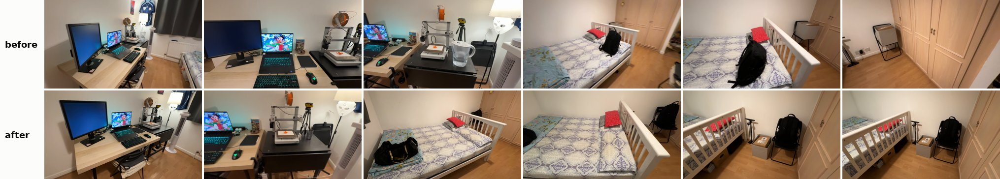
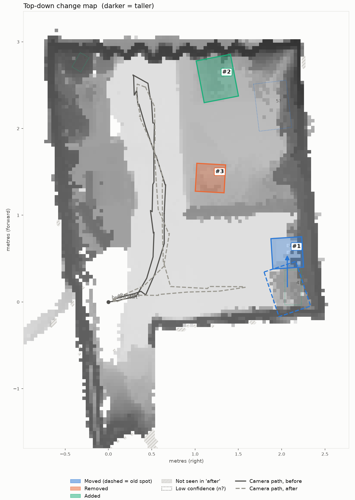
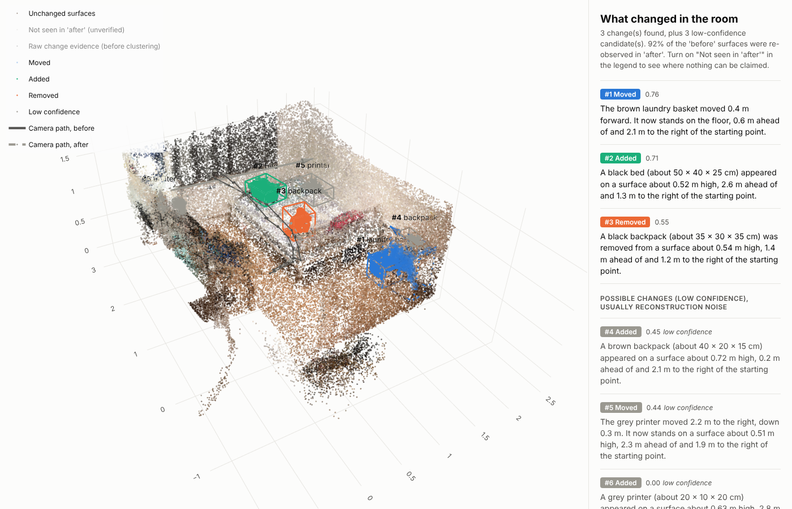
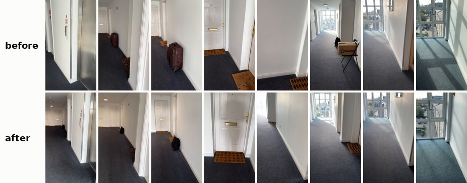
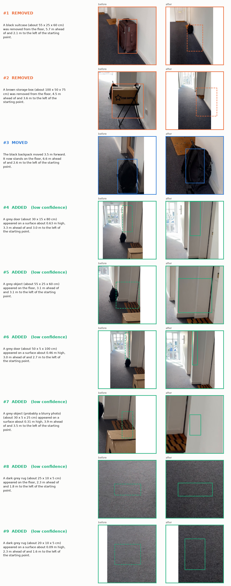

# What changed in the room?

Give it two phone videos of the same space. It builds one shared 3D model, finds what was **moved, added or removed**, and says so in plain English with a size, a position and a confidence. It also says where it **cannot** tell, because the second video never looked there.





```
before_A.MOV vs after_A.MOV   (iPhone 15 Pro, 0.5x lens, landscape, 55 s each; held out, see below)
3 confident change(s), 3 low-confidence  |  'before' re-observed: 92%
  #1 moved    [0.76] The brown laundry basket moved 0.4 m forward. It now stands on the floor, ...
  #2 added    [0.71] A black bed (about 50 x 40 x 25 cm) appeared on a surface about 0.52 m high, ...
  #3 removed  [0.55] A black backpack (about 35 x 30 x 35 cm) was removed from a surface about 0.54 m high, ...
  #4 added    [0.45] A brown backpack (about 40 x 20 x 15 cm) appeared on a surface about 0.72 m high, ...  (low confidence)
  #5 moved    [0.44] The grey printer moved 2.2 m to the right, down 0.3 m. ...                           (low confidence)
```

What actually changed: a grey storage box went from the folding chair's seat to the floor beside it (#1, right). A black duffel bag was put on the bed (#2, right place, wrong name: the crop is mostly bed). The backpack moved 1.7 m from the bed to the chair: #3 and #4 are its two ends, the arrival only at low confidence, and the matcher did not pair them. It sits on the seat where the box used to be, so most of its volume fills space that was already occupied; only a 14 cm slice above the old box counts as new, too small and too light-coloured to match the removal. The water jug was taken off the side table (#5 finds the empty spot, at low confidence, and pairs it with nothing real). Nothing that stayed put was reported as confidently changed.

These are **new held-out recordings of a room used earlier in development** (then cluttered and filmed differently), **evaluated once with frozen settings** ([heldout/FREEZE.json](heldout/FREEZE.json), with file hashes). Nothing was tuned on them. It shows transfer to new captures, not to an unseen room.

## Data

All eight phone videos are public, unedited (sound included), in the [latest release](../../releases/latest), with SHA-256 checksums in `SHA256SUMS.txt`:

| file | contents | capture |
|---|---|---|
| `room_videos.zip` (318 MB) | `before_A`, `before_B`, `after_A`, `after_B`: the held-out room | iPhone 15 Pro, 0.5x lens, landscape, 1080p 30 fps SDR, about 55 s each, phone at about 1.20 m |
| `corridor_videos.zip` (196 MB) | `before_Left`, `before_Right`, `after_Left`, `after_Right`: the corridor | iPhone 15 Pro, 1x lens, portrait, 1080p 30 fps SDR, 45 to 50 s each, phone at about 1.20 m |
| `reconstructions.zip` (269 MB) | the six VGGT reconstructions not shipped in `examples/` | for `scripts/ablation.py` without a GPU |

The room_A and corridor_right reconstructions, with their keyframes, are in `examples/` already. Ground truth for both scenes is in this README and in [examples/ground_truth.json](examples/ground_truth.json).

## The idea in one paragraph

Two recordings never see the same surfaces. A plain point cloud diff reports everything the second camera missed as "removed". This system asks a different question of every 3D point: **did the other recording's cameras see through the place where this point was?** If a camera measured depth *behind* the point, the point is gone. If something was in front, or the point was off screen, there is no evidence either way and the point is marked **unverified**, never "changed". Gone points become objects, objects that vanished in one place and appeared in another become moves, and CLIP plus the measured size give them names. Every change gets a confidence score built from its evidence, and weak ones are listed separately instead of hidden.

On the same point clouds, a plain nearest-neighbour diff reports 12 to 40 changes per comparison away from any real change. The visibility test alone brings that to 1 to 9, and the confident tier to 0 or 1 everywhere except the opposite-direction corridor walk (3) ([full table and its limits](examples/ablation.md)).

## Results at a glance

| data | role | real changes | reported as the right confident event | confident predictions | spatial false positives | wrong associations |
|---|---|---|---|---|---|---|
| **Room**, 4 videos (3 change pairs + 1 no-change pair) | **held out**: new recordings, frozen settings | 12 | **5**, plus 2 found at one end only | 9 | **0** (no-change pair: 0) | 2 |
| Corridor, 4 videos (3 + 1) | development set: thresholds tuned on it | 9 | 8 | 10 | 2 (1 opposite-direction, 1 in the no-change pair) | 0 |
| Synthetic room | geometry check, exact ground truth | 4 | 2 (the other 2 at low confidence) | 2 | 0 | 0 |

Read it this way: in the room, all nine confident predictions sit on genuine change locations, and with nothing changed there are none; but two of them pair the wrong objects, and several real changes are found only at one end, at low confidence, or not at all. A "spatial false positive" is a confident prediction away from any real change. Counts come from the published reports, with CLIP on.

Interactive 3D views (download and open in a browser): [room_A](examples/room_A/scene.html), [corridor_right](examples/corridor_right/scene.html). Every comparison's report, map and evidence sheet is in `examples/`.



## Try it without a GPU

The repo ships the reconstructions of one room pair and one corridor pair, with their keyframes, so the whole analysis reruns on a laptop CPU in about a minute.

**Linux / macOS**

```bash
pip install -r requirements.txt
mkdir -p results/room_A && cp -r examples/room_A/recon.npz examples/room_A/frames results/room_A/
python -m roomdiff reanalyse --out results/room_A --camera-height 1.20
```

**Windows (PowerShell)**

```powershell
pip install -r requirements.txt
New-Item -ItemType Directory -Force results\room_A | Out-Null
Copy-Item examples\room_A\recon.npz, examples\room_A\frames results\room_A\ -Recurse
python -m roomdiff reanalyse --out results\room_A --camera-height 1.20
```

That rebuilds the report, map, evidence sheet, 3D page and PLY files, with CLIP labels (downloads about 600 MB of CLIP weights the first time). The same works for `corridor_right`.

Expected output:

| | with CLIP (default) | with `--no-clip` |
|---|---|---|
| room_A | 3 confident, 3 low confidence, as in `examples/room_A/report.md` | 4 confident, 2 low confidence |
| corridor_right | 3 confident, 6 low confidence | 3 confident, 10 low confidence |

`--no-clip` changes more than the names. CLIP similarity is one of the move-matching costs, and CLIP suppresses candidates that look like bare wall or floor. Without it, room_A's wrong jug pairing scores 0.54 instead of 0.44 and crosses the threshold, and the corridor keeps four wall-like candidates in the low-confidence list ([details](docs/ENVIRONMENT.md)).

`python -m roomdiff demo` runs the full pipeline on a synthetic room with known ground truth and scores itself.

## Run it on your own videos

Python 3.10 to 3.12, an NVIDIA GPU with 8 GB or more, Git. Record following [docs/RECORDING.md](docs/RECORDING.md), then:

**Windows.** `run_all.bat` sets up a venv, PyTorch and VGGT the first time, checks the GPU, reconstructs every pair, then analyses them. By default it reproduces the four corridor comparisons (unzip `corridor_videos.zip` from the release into `data\`). For your own videos, name the pairs and the phone height in metres:

```powershell
powershell -ExecutionPolicy Bypass -File scripts\run_all_windows.ps1 -Height 1.20 -Pairs "mine=data\before.mov,data\after.mov"
```

`run_room.bat` reproduces the room results the same way (unzip `room_videos.zip` from the release into `data\`, which creates `data\room_clips\`). Both launchers check that the videos are there first, set up the environment on a fresh checkout, stop at the first failed step, and exit with an error code.

**Linux**

```bash
pip install torch torchvision --index-url https://download.pytorch.org/whl/cu128
pip install -r requirements.txt
bash scripts/install_vggt.sh
python -m roomdiff check data/before.mov data/after.mov
python -m roomdiff run --before data/before.mov --after data/after.mov --out results/mine --camera-height 1.20
```

**No local GPU?** `notebooks/colab.ipynb` runs on a free Colab T4.

| command | what it does | GPU |
|---|---|---|
| `check` | scores footage: blur, blank surfaces, gaps, turning on the spot | no |
| `run` | full pipeline | yes |
| `reconstruct` | GPU step only, writes `recon.npz` and the keyframes | yes |
| `reanalyse` | detection and all outputs from a cached `recon.npz` | no |
| `demo` | synthetic room with ground truth | no |
| `doctor` | checks the install and shows the frame plan for your GPU | no |

The tested versions (VGGT is pinned to a commit) are in [docs/ENVIRONMENT.md](docs/ENVIRONMENT.md).

## Outputs

| file | what it is |
|---|---|
| `scene.html` | Interactive 3D view: shared point cloud, coloured change boxes, move arrows, both camera paths, toggles for low-confidence changes, unverified space and raw evidence |
| `topdown.png` | Floor plan with every change numbered; low-confidence ones dotted and marked `n?` |
| `evidence.png` | Before and after crops from the original video for each change |
| `report.md`, `report.json` | Plain-English list; boxes, sizes, displacements, rotations, confidence and the evidence behind it; coverage; every candidate a filter rejected, with the reason |
| `cloud_before.ply`, `cloud_after.ply`, `changes.ply` | Point clouds for MeshLab or CloudCompare |

Colour code everywhere: **blue** moved (dashed = old spot), **orange** removed, **green** added, **grey** low confidence, **hatched** not verified. Every change also carries its number, so colour is never the only cue.

## How it works

```
before.mov ─┐   sharp keyframes,       ┌─ gravity from camera "down" axes
            ├─ padded to square ─ VGGT ┤─ floor plane (RANSAC) → metric scale from camera height
after.mov ──┘   (passes stitched by    └─ depth + cameras for every frame, one shared frame
                 shared anchor frames)              │
                         point-to-plane ICP refines after onto before
                                                    │
     every point of one scan vs every camera of the other: present / gone / unobserved
                                                    │
     cluster gone points → drop walls, poles, cables, see-through structures and floor noise
                                                    │
   re-register each candidate locally → check it also *looks* different → confidence score
                                                    │
      CLIP label × size check → match removed↔added → moved / added / removed → text + visuals
```

1. **Keyframes.** Each video is split into equal time bins and the sharpest frame of each bin is kept. iPhone HDR footage is tone-mapped to SDR first.
2. **One shared reconstruction.** Keyframes from both videos go through [VGGT](https://github.com/facebookresearch/vggt) together, so all cameras and depth maps land in one coordinate frame. When the frames do not fit on the GPU at once, they run in several passes that share 8 anchor frames, and a closed-form similarity fit on the anchors' depth ties the passes together (pixel-identical correspondences, no feature matching).
3. **Room frame.** Gravity comes from how people hold phones. The floor is a RANSAC plane perpendicular to it. Metric scale comes from the camera height above that floor.
4. **Visibility votes.** Every 3D point is projected into every camera of the *other* recording and compared with the depth that camera measured. See-through means gone, agreement means present, occlusion or off-screen means no evidence. The tolerance grows at grazing angles, depth edges and low-confidence pixels never vote "gone", and the floor itself is never "gone".
5. **Objects and filters.** Gone points are clustered into regions. Regions shaped like a slice of wall or floor, a pole or a cable, or full of depth edges (railings, slats, spokes) are dropped and listed with the reason.
6. **Checks against real change.** Each candidate is re-registered against the scene within 60 cm of it; if it disappears, it was a local alignment error. Then the original pixels are compared: a real change also looks different, not just measures different.
7. **Confidence.** Size, appearance, compactness, the local check, how many independent views saw through the region, and whether it is a thin slab (a door leaf) combine into a score from 0 to 1. At 0.5 or above it is reported as a change; below, as "possible change (low confidence)".
8. **Semantics and moves.** The best view of each region is cropped from the full-resolution frame and labelled by CLIP. A label that contradicts the measured size (a 60 cm "door") is replaced by "object". A removal and an addition with matching size, colour and CLIP embedding become a move.

Reasoning behind each choice, alternatives and trade-offs: [docs/DESIGN.md](docs/DESIGN.md).

## Results

### Held-out test: new recordings of my room

Four videos of my bedroom (about 3 x 3 m, cleared of the bike and loose clutter), iPhone 15 Pro, **0.5x lens, landscape**, 1080p 30 fps, phone at about 1.20 m, 55 s each. Path A starts at the door and goes desk, bed, wardrobe; path B goes the other way round.

| video | content |
|---|---|
| `before_A`, `before_B` | the room as it was, two different paths |
| `after_A`, `after_B` | after the changes, two different paths |

Ground truth (written down while recording, backpack distance measured with a tape):

1. **Removed:** water filter jug, from the black side table.
2. **Moved:** black backpack, from the bed to the folding chair, about 1.7 m.
3. **Moved:** grey storage box, from the folding chair's seat to the floor beside it.
4. **Added:** black duffel bag, on the bed.

Protocol: every detection setting was developed on the corridor, the first (failed) recordings of this same room, and the synthetic room. Then the code was frozen and hashed ([heldout/FREEZE.json](heldout/FREEZE.json)), the room was reconstructed, and each pair was analysed once. Later edits touch only presentation and synthetic scoring (the 3D page sidebar, the demo's metrics). They are listed in the same file, and `python scripts/verify_freeze.py` checks that every detection file still matches its frozen hash.

| change | room_A (before_A vs after_A) | room_B (before_B vs after_B) | room_cross (before_A vs after_B) |
|---|---|---|---|
| jug removed | found, low confidence (0.44), wrongly paired as a "move" to an empty spot | **found** (0.50), labelled "printer" (the printer fills the crop) | found, low confidence (0.44) |
| backpack, bed to chair | **removal found** (0.55); arrival on the chair low confidence (0.45), not paired | arrival paired with the box's old spot on the same seat: **wrong pairing** (0.59); old spot missed | old spot paired with the duffel bag on the bed: **wrong pairing** (0.65); arrival low confidence (0.42) |
| box, seat to floor | **found as a move** (0.76), 0.4 m | new spot **found** (0.68); old spot used in the wrong pairing | **found as a move** (0.70): 0.2 m, down 0.3 m |
| duffel bag added | **found** (0.71), labelled "bed" | **found** (0.81), "black bag" | used in the wrong pairing |

**Nothing changed (`room_null`, before_A vs before_B):** 0 confident changes. 4 low-confidence candidates, the highest at 0.33.

What this shows:

* **Where things changed is right.** Across the three change pairs, every confident box sits on a spot where something really changed. The no-change pair reports nothing. That is the hard part of the brief (viewpoint, occlusion, incomplete coverage), and it held on data the system never saw.
* **Which object went where is the weak part.** Both wrong pairings come from the same situation: two dark bags change on the bed, and two different objects take turns on the same chair seat. The matcher pairs a removal with an addition by size, colour, CLIP similarity and support height, and these pairs agree on all four. It has no notion of "replaced by a different object in the same place". That is the next thing I would fix (see the design notes).
* **Labels are hit and miss.** "Black bag", "backpack" and "storage box" are right. "Bed" for the duffel and "printer" for the jug are not: the best view crops too much context. The size check only catches labels that contradict the height.
* **Metric scale is good.** The backpack's measured move, from its removal box to its arrival box, is 1.58 m, against 1.7 m by tape (7% off). Scale comes only from the 1.20 m camera height.
* **The wide lens helped.** Even though the footage check flags the room clips as mostly turning on the spot, the 0.5x lens gives enough overlap and parallax in a small room. The stitch residual between passes was 0.3% of the scene size (corridor: 0.7 to 1.6%).

### Development set: the corridor

Four iPhone 15 Pro videos of the corridor in my flat (about 10 m of it), portrait, 1x lens, phone at about 1.20 m, 45 to 50 s each. `Left` and `Right` clips walk in opposite directions. Before: brown suitcase, black folding chair with a cardboard box on it, black backpack. After: suitcase and chair removed, backpack moved further along.



| pair | walking directions | confident changes found | confident false positives | low-confidence candidates |
|---|---|---|---|---|
| `corridor_right`: before_Right vs after_Right | same | **3 of 3** (suitcase 0.76, chair+box 0.67, backpack moved 3.5 m 0.55) | **0** | 6 |
| `corridor_same`: before_Left vs after_Left | same | **2 of 3** (suitcase 0.63, chair+box 0.68); backpack listed as removed at 0.49, its new spot is never filmed | **0** | 4 |
| `corridor_cross`: before_Left vs after_Right | opposite | **3 of 3** (backpack moved 3.8 m 0.74, suitcase 0.70, chair+box 0.66) | 1 (door frame "moved", 0.58) | 4 |
| `corridor_null`: before_Left vs before_Right | opposite, **nothing changed** | | 1 (half of the unchanged suitcase, 0.50) | 5 |

The thresholds and confidence weights were set on these recordings, so they show what the system can do, not how it generalises. That is what the room is for.

* **Same walking direction is clean.** Every confident change is real.
* **Opposite directions are harder.** Walking one way and then the other shares few views of the same surfaces, so the two halves register less tightly. ICP corrects 1.75 to 3.1 degrees on those pairs, against 0.1 to 0.2 for same-direction pairs, and door frames several metres away still end up a few centimetres off. The confidence score now discounts regions seen through by only one or two frames and thin slabs like door leaves. That removed most of these false positives, but not all.
* **Labels:** "brown storage box" for the chair with a box on it is fair. The suitcase is brown and CLIP calls it black in the dim corridor.



### What each part contributes

[examples/ablation.md](examples/ablation.md) runs four detectors on the same reconstructions and point clouds: a nearest-neighbour diff, the visibility test alone, the full pipeline with all candidates, and its confident tier. In the room no-change pair they report 23, 3, 4 and 0 spatial false positives; in corridor_right 40, 3, 7 and 0, while still hitting every real change location. It is a coarse location check: it does not judge object identity or pairing, and its reference locations were read off the change boxes and checked by eye.

### An earlier attempt that failed

The first recordings were of the same bedroom before I cleared it, in portrait on the 1x lens. The camera mostly turned on the spot (rotation-only scores of 0.84 and 0.91 from `check`), and the room was full of thin, see-through clutter: a bike, bed slats, cables. The reconstruction did not look like the room, the no-change test produced many false positives, and CLIP named a water filter jug "kettle". Several filters (depth-edge, pole and cable, local re-registration, appearance), the portrait padding fix and the footage checker came out of that failure. Clearing the room and switching to the 0.5x lens in landscape is what made the held-out test possible.

### Synthetic room with ground truth

`python -m roomdiff demo` renders a room with a ray caster, adds depth noise, and hides scale and gravity behind a random transform so the full pipeline has to recover them.

| change | found | confidence | horizontal error | vertical error |
|---|---|---|---|---|
| chair moved 1.3 m, turned 90 degrees | yes, turn estimated 90 degrees | 0.99 | 0.00 m (of the displacement) | 0.01 m |
| box removed | yes | 0.50, low | 0.01 m | 0.00 m |
| backpack added on floor | yes | 0.58 | 0.01 m | 0.00 m |
| bottle added on table | yes | 0.13, low | 0.00 m | 0.00 m |
| bin only seen by "before" | correctly not reported, 100% of its points marked unverified | | | |

All candidates: precision 1.00, recall 1.00. Confident only: precision 1.00, recall 0.50. The flat-coloured synthetic boxes give the appearance check little to work with, which is why two land below the threshold. Metric scale error is under 1%. This checks the geometry and visibility logic only, not VGGT's depth.

## Settings that matter

| flag | default | when to change it |
|---|---|---|
| `--camera-height` | 1.35 | Phone height above the floor in metres. Sets the metric scale. |
| `--frames` | from GPU memory | Frames per video. More frames are stitched over more passes. |
| `--max-side` | 518 | VGGT input size |
| `--scale` | estimated | If the floor is never visible |
| `--no-clip` | off | Skip semantic labels |

All thresholds live in `roomdiff/config.py`, each with a one-line reason.

## Tests

```bash
python -m pytest -q
```

16 tests. Unit tests cover projection, voxelisation, floor and gravity estimation, the three-state visibility logic, portrait padding, the reconstruction cache and the multi-pass stitching (pass planning, recovery of a known similarity transform, and the synthetic room run through stitched passes), plus the ablation script's ground-truth parsing and scoring. The end-to-end test runs the synthetic room and fails if any planted change is missed, anything extra is reported in either tier, or the unseen corner gets flagged.

## Limitations

* **Move pairing** fails when similar objects change near each other, or when one object replaces another in the same spot (room results above).
* **Opposite-direction recordings** register a few degrees off. Door frames and wall edges far from the cameras can then look changed.
* **Confidence scores are heuristic evidence scores, not calibrated probabilities.** Their weights and the 0.5 tier were set on the corridor and the earlier recordings; the only held-out check is new recordings of one room that was also used, in a different state, during development.
* **Labels** come from one crop per object and can name the surroundings instead (a duffel bag on a bed called "bed").
* Objects moved less than their own size only register where old and new positions do not overlap.
* Things thinner than the depth tolerance (paper, a flat book, a doormat) are below the noise floor. Floor-level changes under 8 cm are ignored on purpose.
* Scale relies on the camera height. A wrong height scales every size and distance by the same factor.
* VGGT-1B weights are licensed for non-commercial use.

## Repository layout

```
roomdiff/
  frames.py                  HDR tone mapping, keyframe selection, footage check
  backends/vggt_backend.py   joint reconstruction, GPU memory planning, square padding
  backends/stitch.py         multi-pass reconstruction tied together by anchor frames
  backends/synthetic.py      ray-cast test room with ground truth
  geometry.py                projection, floor, gravity, scale, ICP refinement
  changes.py                 visibility votes, clustering, filters, local checks, confidence, moves
  semantics.py               best view, CLIP with size checks, colour names
  describe.py                plain-English descriptions
  visualize.py               3D page, top-down map, evidence sheet, PLY
  pipeline.py                orchestration
  evaluate.py                synthetic scoring
  config.py                  every threshold, with a reason
examples/
  room_A/                    held-out room recordings: full outputs, reconstruction and keyframes
  room_B/, room_cross/, room_null/
  corridor_right/            corridor: full outputs, reconstruction and keyframes
  corridor_same/, corridor_cross/, corridor_null/
  synthetic/                 demo outputs and its evaluation
  ablation.md                baseline comparison
  ground_truth.json          where each real change is, per comparison
heldout/FREEZE.json          settings and code hashes frozen before the new room recordings were analysed
docs/                        design notes, recording guide, tested environment
notebooks/colab.ipynb        run on a free Colab GPU
scripts/                     setup, batch runs, ablation, input contact sheets
tests/                       unit, stitching and end-to-end tests
```

The original videos (`room_videos.zip`, `corridor_videos.zip`) and the other six reconstructions (`reconstructions.zip`) are attached to the GitHub release, with SHA-256 sums. Unzip `reconstructions.zip` into `examples/` to run `scripts/ablation.py` on every pair.

## License

* **Code**: [MIT](LICENSE).
* **Data**: the phone videos, keyframes, reconstructions and example outputs are released under [CC BY 4.0](https://creativecommons.org/licenses/by/4.0/): reuse them freely, with credit.
* **Third-party models** keep their own terms and are not redistributed here. VGGT-1B weights (downloaded from Hugging Face on first run) are licensed for non-commercial use only, so the reconstruction step inherits that restriction. The CLIP model comes from open_clip, under its own licence.
